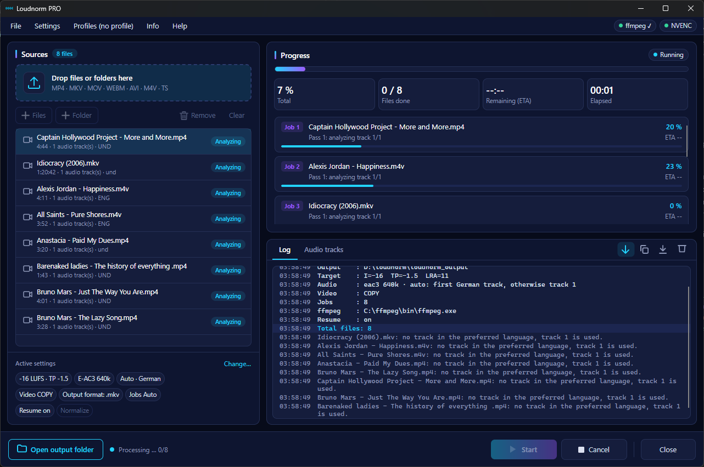

# Loudnorm PRO 2.0 (Avalonia)

Batch-Lautheitsnormalisierung für Videos nach **EBU R128** (2-Pass `loudnorm`) mit FFmpeg und Hardware-Encoding.
Läuft nativ auf **Windows, macOS (Apple Silicon/Intel) und Linux**.

Praxistests unter Windows 11 und CachyOS verliefen erfolgreich. Das DMG für Apple Silicon ist notarisiert. Der Start der installierten App wurde auf macOS geprüft.

[Version 2.0.0 herunterladen](https://github.com/urscaviezel/Loudnorm-PRO/releases/tag/v2.0.0) · [Fehler melden](https://github.com/urscaviezel/Loudnorm-PRO/issues)



## Windows-Update von v1.0.4 auf v2.0.0

Die Updatesuche in v1.0.4 erkennt v2.0.0 und lädt den Installer herunter. Das Setup installiert v2 standardmässig im eigenen Ordner `Loudnorm PRO 2`. Beide Versionen können parallel installiert bleiben. Auch bei Auswahl des bisherigen Installationsordners bleibt v1 installiert. Wer nur v2 verwenden möchte, kann v1 über die installierten Apps in Windows manuell deinstallieren.

Loudnorm PRO 2.0.0 startet nach der Installation mit normalen Benutzerrechten.

---

## Projektstruktur

```
LoudnormPro.sln
├─ src/LoudnormPro.Core/        Logik ohne UI (testbar)
│   ├─ Platform/                 Datenordner, Prozessstart, ffmpeg/ffprobe-Suche
│   ├─ Media/                    ffprobe, Dateinamen-Regeln, loudnorm-Messwerte
│   ├─ Processing/               Spurauswahl, Video-Encoder, Pipeline, Batch, Resume, sicheres Ersetzen
│   ├─ Settings/                 Einstellungen (kompatibel zu v1) + Profile
│   ├─ Localization/             Sprachdateien (JSON)
│   └─ Services/                 Update-Prüfung, Energieoptionen, FFmpeg-Diagnose
├─ src/LoudnormPro.App/          Avalonia-Oberfläche (MVVM, CommunityToolkit.Mvvm)
│   ├─ Languages/                de.json, en.json, fr.json
│   ├─ Themes/                   Styles (Farben in App.axaml, nach pfdhub.com)
│   ├─ ViewModels/  Views/  Services/
├─ tests/LoudnormPro.Core.Tests/ xUnit-Tests (38)
└─ tools/                        Build-Skripte
```

## Bauen & Starten

Voraussetzung: **.NET 10 SDK** und **FFmpeg** (ffmpeg + ffprobe).

```bash
dotnet build LoudnormPro.sln
dotnet test tests/LoudnormPro.Core.Tests
dotnet run --project src/LoudnormPro.App
```

Debug-Builds laufen **portabel** (`portable.mode` im Build-Ordner): Einstellungen, Logs und Resume-Datei bleiben im Build-Ordner und berühren die installierte v1 nicht.

### Pakete erstellen

| System | Befehl | Ergebnis |
|---|---|---|
| Windows | `tools\build-windows.cmd` | `publish\windows\LoudnormPRO.exe` (portabel, den ganzen Ordner samt DLLs und `portable.mode` kopieren) |
| macOS (auf dem Mac) | `./tools/build-macos.sh` | `publish/macos/Loudnorm PRO.app` + `.dmg` (Apple Silicon; `osx-x64` für Intel) |
| Linux | `./tools/build-linux.sh` | `publish/linux/LoudnormPRO-<version>-linux-x64.tar.gz` |

macOS: ffmpeg per Homebrew (`brew install ffmpeg`) wird automatisch unter `/opt/homebrew/bin` gefunden.
Das Release-Skript signiert App und DMG mit Developer ID und reicht das DMG zur Notarisierung ein. Nach Annahme heftet es das Ticket an und prüft es mit Gatekeeper. Zertifikat und Notarisierungszugang werden auf dem Mac im Schlüsselbund eingerichtet. Über `SIGN_IDENTITY` und `NOTARY_PROFILE` lassen sich die Vorgaben überschreiben.

## Datenordner

| System | Pfad |
|---|---|
| Windows | `%LOCALAPPDATA%\Loudnorm PRO\` |
| macOS | `~/Library/Application Support/Loudnorm PRO/` |
| Linux | `~/.local/share/Loudnorm PRO/` |
| Portabel | Ordner der EXE (Datei `portable.mode` daneben legen) |

`loudnorm_settings.json` aus v1 wird übernommen; v2 schreibt die v1-Felder weiterhin mit.

## Sprachen hinzufügen

Sprachen sind reine JSON-Dateien, es ist keine Programmänderung nötig.

1. *Einstellungen → Sprache → Vorlage für neue Sprache erstellen…* und einen Code eingeben, z. B. `it`.
   Es entsteht `<Datenordner>/languages/it.json` mit allen englischen Texten.
2. Texte übersetzen, `meta.name` setzen (z. B. `"Italiano"`), speichern.
3. *Einstellungen → Sprache → Sprachdateien neu laden*: Die Sprache erscheint sofort im Menü.

Format:

```json
{
  "meta":    { "code": "it", "name": "Italiano", "englishName": "Italian", "author": "…", "version": "2.0.0" },
  "strings": { "menu.file": "File", "files.added": "{count} file aggiunti." }
}
```

- Platzhalter in `{geschweiften Klammern}` unverändert lassen.
- Fehlende Texte werden automatisch auf Englisch angezeigt.
- Eine Datei im Benutzerordner mit gleichem Code (z. B. `de.json`) **überschreibt einzelne Texte** der mitgelieferten Sprache. Es genügen die geänderten Schlüssel.
- Mitgelieferte Sprachen liegen in `Languages/` neben der EXE.

## Lautheitsprofile

| Profil | I (LUFS) | TP (dBTP) | LRA |
|---|---|---|---|
| Streaming / Web (Standard, wie v1) | −16 | −1.5 | 11 |
| EBU R128 Broadcast | −23 | −1.0 | 7 |
| YouTube / Spotify | −14 | −1.0 | 11 |
| Benutzerdefiniert | frei | frei | frei |

Eigene Gesamt-Profile (inkl. Audio, Video, Jobs) lassen sich unter *Einstellungen → Profile* speichern.

## Ausgabename und Audiocodec

Unter **Einstellungen → Video & Encoder → Dateinamen-Zusatz** stehen der bisherige Standard, der Originaltitel ohne Tag und ein eigener Zusatz zur Wahl. Der eigene Tag steht direkt vor der Dateiendung: Mit `_TV` wird aus `Film.mkv` bei MP4-Ausgabe `Film_TV.mp4`. «Ohne Tag» verwendet im Quellordner den Standardzusatz. «Originaldateien überschreiben» bleibt eine separate, explizite Option.

Unter **Audio** stehen AAC, E-AC3, Opus und PCM 24-bit zur Wahl. Opus verwendet 48 kHz und eine wählbare Bitrate, PCM die ursprüngliche Abtastrate und 24 Bit ohne Kompression. Passende Beispiele:

| Ton | Videoausgabe |
|---|---|
| Opus | MKV, MP4, MPEG-TS oder WebM. Bei WebM: Video Copy mit VP8, VP9 oder AV1; auch alle kopierten Ton- und Untertitelspuren müssen WebM-kompatibel sein. |
| PCM 24-bit | MKV, MOV oder mit einem kompatiblen FFmpeg auch MP4. Auto kann bei AVI-Quellen AVI beibehalten. |

FFmpeg benötigt für Opus den Encoder `libopus`. Der Analyse-Cache ist unabhängig von Ausgabename, Container und Audiocodec.

## Tastenkürzel

| Aktion | Windows / Linux | macOS |
|---|---|---|
| Dateien hinzufügen | Ctrl+O | ⌘O |
| Ordner hinzufügen | Ctrl+Shift+O | ⇧⌘O |
| Ausgabeordner öffnen | Ctrl+E | ⌘E |
| Einstellungen | Ctrl+, | ⌘, |
| Start | F5 | F5 |
| Abbrechen | Esc | Esc |
| Auswahl entfernen | Entf (in der Liste) | ⌫ |

## Lizenz

GNU GPL v3 · FFmpeg (ffmpeg.org) · Avalonia UI
